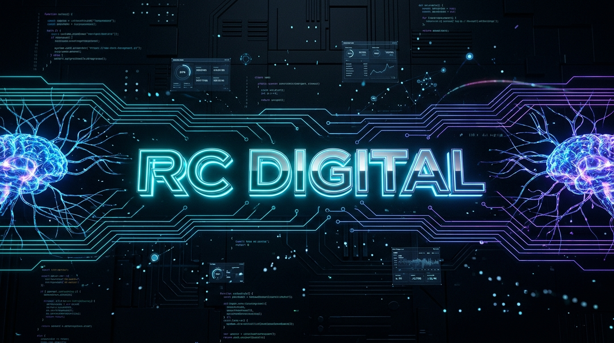

<div align="center">

<!-- HEADER BANNER -->


</div>

<p align="center">
  
</p>

<div align="center">


</div>

---

# ⚡ RAFAEL COSTA | AGÊNCIA RC DIGITAL

```yaml
status: ONLINE & SCALING
role: Founder & Head de Tecnologia na Agência RC Digital
location: Tucuruí - PA | Atendimento Nacional
specialties:
  - Desenvolvimento Web & WordPress Headless
  - SEO Técnico & Otimização Core Web Vitals
  - GEO (Generative Engine Optimization) & AEO
  - Agentes de IA & Automação Operacional
  - Tráfego Pago & Otimização de Conversão (CRO)
```

---

## 🧠 QUEM SOU EU

```bash
> whoami
Rafael Costa — Estrategista Digital, Desenvolvedor e Consultor de SEO.

> cat /missao.txt
À frente da Agência RC Digital, construo soluções digitais integradas onde
tecnologia, design, tráfego e inteligência artificial trabalham juntos para:
• Atrair o público certo com SEO de alto impacto e tráfego qualificado
• Reter e converter visitantes com páginas ultra-rápidas e responsivas
• Posicionar empresas no topo do Google e nos mecanismos de busca por IA (GEO)
• Automatizar rotinas, atendimento e funis de vendas com IA e integrações

Transformando presença online em faturamento real e escalável.
```

---

## 🚀 SOLUÇÕES & ECOSSISTEMA

<div align="center">

| Especialidade | O Que Eu Entrego | Impacto |
| :--- | :--- | :--- |
| 🌐 **Sites & Landing Pages** | WordPress moderno, LP focada em conversão, mobile-first e alta velocidade | Máxima taxa de conversão e retenção |
| 🔍 **SEO Técnico & Local** | Otimização on-page, arquitetura semântica, Schema.org e Google Meu Negócio | Primeiras posições orgânicas no Google |
| 🤖 **GEO & Presença em IA** | AEO, estruturas em dados, entidades e contexto para ChatGPT, Gemini e Claude | Destaque nas respostas de buscas com IA |
| 🎯 **Tráfego Pago & Performance** | Campanhas avançadas em Google Ads e Meta Ads com rastreamento ponta a ponta | Menor CAC e geração consistente de leads |
| ⚡ **Sistemas & Automações** | CRM sob medida, webhooks, WhatsApp APIs e agentes autônomos inteligentes | Menos trabalho manual, mais escala operacional |

</div>

---

# 🛰️ CENTRAL OPERACIONAL

```ascii
╔══════════════════════════════════════════════════════════════════════╗
║             R C   D I G I T A L   —   O P E R A T I O N S            ║
╠══════════════════════════════════════════════════════════════════════╣
║                                                                      ║
║  🟢 SITES & LANDING PAGES       STATUS: ULTRA-RÁPIDOS                ║
║  🟢 SEO & BUSCA LOCAL           STATUS: RANQUEANDO                   ║
║  🟢 GEO & VISIBILIDADE EM IA    STATUS: INDEXADO                     ║
║  🟢 AUTOMAÇÕES & AGENTES        STATUS: EXECUTANDO 24/7              ║
║  🟢 TRÁFEGO PAGO & FUNIS        STATUS: ESCALANDO                    ║
║  🟢 CRM & PIPELINES             STATUS: INTEGRADOS                   ║
║                                                                      ║
║  ⚡ "NÃO SE TRATA APENAS DE ESTAR NA INTERNET.                       ║
║      SE TRATA DE SER ENCONTRADO, CONVENCER E CONVERTER."             ║
║                                                                      ║
╚══════════════════════════════════════════════════════════════════════╝
```

---

## ⚙️ TECH STACK & FERRAMENTAS

<div align="center">

### Desenvolvimento & Engenharia


<br/>

### Marketing, SEO, IA & Analytics
<p align="center">
  
  
  
  
  
  
</p>

</div>

---

## 📊 GITHUB STATS

<div align="center">


</div>

---

## 📡 FILOSOFIA DE TRABALHO

```txt
Muitos criam sites que parecem vitrines abandonadas.
Muitos investem em anúncios que atraem cliques, mas não vendem.

A minha abordagem une quatro engrenagens indispensáveis:
1. UX & Velocidade: Uma experiência sem atrito onde cada elemento tem um propósito.
2. Descoberta Estratégica: Estar visível exatamente quando o cliente procura (no Google e nas IAs).
3. Automação Inteligente: O lead não espera — respostas imediatas qualificam e convertem.
4. Análise de Dados: Decisões baseadas em métricas reais de conversão, e não em achismos.
```

---

## 🤝 VAMOS CONVERSAR SOBRE O SEU PROJETO?

<div align="center">

[](https://agenciarcdigital.com.br/)
[](https://wa.me/5594992118777)
[](https://www.instagram.com/rafaoseo)
[](https://www.youtube.com/@rafaonaresenha)
[](https://www.linkedin.com/in/rafael-gomes-costa-b4066a96/)

<br/>

📧 **E-mail:** `contato@agenciarcdigital.com.br` | 📍 **Localização:** Tucuruí - PA (Atendimento Brasil)

</div>

---

<div align="center">

<!-- FOOTER BANNER -->


</div>

